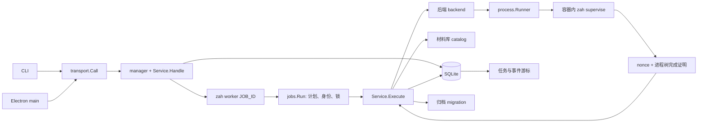

# Go 核心与开发态使用

本文件描述源码中的实际调用关系。真实应用兼容性、宿主权限、声音/登录和跨电脑恢复需要另外验证；源码通过测试不等于这些能力已经通过。

## 一个程序，管理角色与内部监督角色

`cmd/zah/main.go` 调用 `bootstrap.RunCLI`，返回值成为进程退出码。CLI 的 help/version/paths/doctor 在当前进程结束；管理操作经本用户 Unix socket 交给 manager。manager 和 worker 是同一个可执行文件的子命令。显式配置 process-tree 生命周期的 Linux 应用启动还会把该静态二进制的独立副本放入受管私有目录，以内部 `supervise` 子命令在容器里监督应用后代；它不是 manager/worker 内部的普通函数调用。



CLI `rpc` 每次建立连接、握手、执行一次请求；Electron main 管理连接并只向 renderer 暴露白名单操作。manager 不监听 TCP。连接建立不启动 Docker、Bottles 或安装器。

耗时任务在子进程 worker 内完成。worker 自己打开 SQLite、记录 PID/启动时间/boot 身份并保存进度。其日志不连到旧 manager 的管道；底层连接断开不会取消任务。正常关闭 ZaH 窗口是另一套显式策略：Electron main 原生确认后提交全部停止，核实逐项结果才退出，取消或失败会留窗。任务取消通过数据库请求，不能把网络请求超时或 job.cancel 当作应用已安全停止。

## 数据对象怎样传递

| 对象 | 含义与归属 |
| --- | --- |
| AppFamily | 应用分组，例如同一产品；不通过文件名自动认定身份 |
| AppRelease | 平台、版本备注、架构和材料摘要集合；版本标签不是唯一键 |
| AppInstance | 某一副本，关联 Release、Environment、配方摘要、私有目录与入口 |
| Environment | 管理记录 ID 和上游资源身份分开；Docker 完整 ID/名称/标签需同时吻合 |
| Artifact | 文件内容 SHA256、长度、归档位置、原始来源；文件字节不塞进 SQLite |
| recipe.Recipe | 严格声明式策略；内容摘要固定，不提供任意 shell 模板 |
| domain.Plan | 不可变操作内容、前提、材料摘要、影响和步骤；安装/清理先审核，运行按钮直接提交其计划 |
| domain.Job | 某次执行的幂等键、状态、步骤位置、worker 身份和结果 |
| domain.Record | SQLite 通用外壳：kind/id/data/时间；data 是具体对象的 JSON |
| backend.InstallRequest | 从已登记对象组装的执行请求，不能由 RPC 直接任意提供命令 |
| backend.Evidence | 后端身份、状态和操作证据，回到 service 后清除原始 stdout/stderr |
| process.Command/Result | 内部 argv/环境/超时请求与有界进程结果；不直接暴露给 renderer |
| SuperviseStarted/Completion | 本次 nonce 对应入口启动/后代回收证明；不证明窗口关闭意图 |
| StopAllResult | 冻结目标的逐项 stopped/failed 等状态与计数，失败不伪装为全部完成 |

`service.record` 把实体编码成 Record；`storage` 负责事务、引用及查询；`service.get[T]` 将 Record.Data 解回具体类型。同一进程里传 Go 值，跨 socket 时传 JSON，跨 manager/worker 时主要传任务 ID 并从数据库读取持久事实。

## 持久化边界

`$XDG_DATA_HOME/zah/catalog.sqlite` 保存实体、计划、任务、引用和事件。数据库使用 WAL、有限 busy timeout、短事务、外键保护；每个 Go 进程单独打开连接。运行外部命令期间不持数据库写事务。

材料文件在 `artifacts/sha256/<digest>`，每个实例的 Linux HOME 在 `instances/<id>/home`。导入使用独立临时副本、摘要复核、同文件系统无覆盖发布；去重保留来源历史。不会把用户原文件硬链接或软链接当作材料归档。

Config/Data/State/Cache/Runtime 由 `infra.Resolve` 按 XDG 统一计算。运行目录和锁必须本用户私有，拒绝链接或不安全父目录。权限不符时明确失败，不偷偷修改宿主目录权限。临时集成测试必须先创建 0700 的隔离根目录。

manager 内存中的连接数、活动 worker 表与互斥锁只用于协调。数据库是任务事实来源；事件按持久递增序号读取。当前界面通过 events.resume 轮询轻量事件；初次或游标失效时取得同事务快照，有变化才刷新数据，不依赖服务主动推送。完整应用库查询有帧大小限制，超限会明确返回错误。

## 从计划到完成

1. `plan.create` 校验输入，生成并保存 Plan。安装计划固定配方摘要、原始材料摘要和具体请求；执行时再次核对。
2. `job.submit` 提交 plan_id 与 idempotency_key。同一键/同一计划返回同一任务；同一键搭配另一计划报冲突。
3. manager 轮询 queued 任务，启动同一程序的 worker。
4. worker 获取任务锁、全局修改锁和按 ID 排序的环境锁，记录自身身份，将任务转 running。
5. worker 调用 Service.Execute，逐步保存上游身份和结果。启动应用时释放全局修改锁，仍保留该环境锁。
6. 完成、失败、等待人工或取消分别进入对应状态。终态不自动重放。

`queued/running/waiting_user/cancel_requested/succeeded/failed/cancelled/interrupted` 是任务状态，不是应用运行状态。安装器退出 0 只说明这条命令成功；入口检查通过才能登记 ready，应用声音/登录/文件能力仍需另验。

manager 崩溃后先检查旧 worker 的完整进程身份；失去 worker 的任务进入 interrupted，不自动重新安装。对副作用未知的失败，保留实例与证据供检查。锁只能约束 ZaH，无法阻止用户在上游 GUI 或终端同时修改环境。

## 日常运行与停止

首页每个应用只显示版本选择与运行按钮；安装、保留副本、文件映射和恢复入口放在高级管理。运行直接 `plan.create(instance.launch)` → `job.submit`，不再弹安装式审核窗口。连接错误时保留原计划和幂等键供核实，不自动新建请求；收到 Job ID 也不表示应用已经成功运行。

Go 的 `claimLaunch` 强制同 AppFamily 互斥，配方 conflict_groups 是额外限制。实时锁与持久 LaunchLease 分开：启动器返回不自动释放占用，旧 launching/needs_inspection 也不自动调和。经适配的 Linux 监督完成并核实精确环境已停止后才清除租约。

配方可选字段 `lifecycle:"process-tree"` 仅允许 Linux，且应在确认入口的全部后台工作由自身进程树派生后声明；默认不启用。D-Bus/既有服务代启动不属于此树，当前没有 SakuraCat 的真实适配验收。未声明时保留启动状态未知和显式全部停止，不自动假定 GUI 已退出。启用后，启动前验证静态 amd64 ZaH 副本、环境身份和映射。专用 supervise 进程设置 child subreaper，入口启动后发布 nonce 匹配的 started marker，独占 wait4 回收后代；只有入口及所有可回收后代结束、无使证明失效的信号时才输出完成证明。service 在证明有效后停止精确容器并复查，不能把裸启动器退出 0 当成全部后代退出。缺证据保留 needs_inspection。

Windows 已有固定 runner/WINEPREFIX 的精确停止与受控启动握手；阻塞启动器、延迟启动和停止失败重试已通过隔离模拟，真实 Flatpak/Wine 仍未验收。支持条件见 [APP_RUN_STOP_ICONS](APP_RUN_STOP_ICONS.md)。

监督器观察进程树，不识别外部窗口 X/最小化意图。若应用点 X 后仍留在托盘，进程没有结束，就不会被当成自然完成；外部 X 强制关闭、相关短提示和额外的可选最小化交互尚未实现。ZaH 自身窗口的原生关闭确认由 Electron main 完成，不能代替其他应用的窗口适配。

## 开发命令

仓库根目录：

```bash
go test ./...
go test -race ./...
CGO_ENABLED=0 GOOS=linux GOARCH=amd64 GOAMD64=v1 go build -o bin/zah ./cmd/zah
./bin/zah version
./bin/zah doctor --json
```

若当前 PATH 没有 Go，本机工具链为 `/home/zzh/.local/opt/go1.27.3/go/bin/go`。这只是本机开发路径，源码不写死该路径。普通启动前可用 `zah paths` 只读查看数据目录。`zah rpc` 会在需要时启动 manager 并创建管理数据；它不是只读检测命令的替代。

桌面开发入口、隔离联调和 Node 依赖见 [桌面层说明](GO_DESKTOP.md)。不要把生产数据目录用于自动测试。最终分发打包、安装、菜单安装、签名与发布尚未执行。

## 能力边界

- doctor 仅检查操作系统/架构和命令路径，不连接 Docker 服务。
- Linux appimage/deb 有真实参数生成、归档验证、资源身份检查和模拟生命周期测试；本轮未运行真实容器或安装器。
- 新安装引导静态检查材料、原子登记应用/版本/配方/专属环境；Windows 原生安装器由用户操作，完成后明确选择并保存入口。旧人工准备后登记路径仍保留；上游名称/runner/目录与实际 PE 入口始终需要核实。完整边界见后端兼容说明。
Windows 已有固定 runner/WINEPREFIX 的精确停止与受控启动握手；阻塞启动器、延迟启动和停止失败重试已通过隔离模拟，真实 Flatpak/Wine 仍未验收。支持条件见 [APP_RUN_STOP_ICONS](APP_RUN_STOP_ICONS.md)。
- 目录/材料 bundle 不包含运行环境和私有数据；完整环境归档流程必须另外满足冷备份及目标恢复条件。
- 数据库事务与文件系统不是一个跨资源 ACID 事务。普通错误有回滚，硬崩溃仍可能留下隔离暂存目录或无引用材料；不会因此覆盖既有对象或自动重放安装。
- 当前无用户授权 helper，不修改系统库、代理、路由、Docker 服务或防火墙。完整开发检查与自动化缺口见 DEVELOPMENT_VALIDATION.md。

模块功能和数据流概要见 [模块与就绪清单](RELEASE_READINESS.md)，通信细节见 [RPC 说明](GO_RPC.md)，后端实测边界见 [兼容记录](compatibility/BACKENDS.md)。

## 首次容器初始化与安装中断核实

Distrobox 的首次 `enter`（即使执行 `id -u`）会初始化用户并安装基础依赖，不能当作普通30秒只读检查。所有受管 `enter` 在 worker 内等待实际完成，不提供会切断包管理事务的强制取消；任务保持持久运行状态。网络或上游安装器卡住需要人工诊断，不能以超时假称操作已回滚。

`plan.create` 的 `instance.verify` 接收 `{id}`，用于已经创建、状态为 `needs_inspection` 的 Linux 安装在人工修复后核实入口。计划固定完整环境身份；执行重新核对身份、私有 HOME、UID、映射和可执行入口。它不重放安装器，不保证应用功能正确，也不清除未知启动租约/token。存在未解决启动、身份变化或不是 Linux 安装时拒绝。审核通过后由 `job.submit` 执行，成功才恢复 `ready`。高级管理的“核实修复后的入口”对应此流程。

默认 XDG 状态父目录若为组可写且尚无 ZaH 状态目录，Go 会将新状态目录放到已验证的私有数据目录 `state/zah` 下；不自动改宿主权限或迁移现有状态。实际位置以 `zah paths` 为准，错误和回归条件见 [开发验收记录](DEVELOPMENT_VALIDATION.md#默认目录启动故障回归2026-11-01)。


安装数据流：归档材料 ID → `installmedia` 静态格式/入口检查 → `installation.configure` 原子登记 → 审阅 `instance.install` → worker 准备环境。Windows `Installation.Stage` 区分 prepared、installer_ready、awaiting_completion、complete；原生 GUI 启动复用既有受控启动/精确停止，不另建不受管进程通道。用户确认并选入口 → `installation.finish` 冻结摘要 → backend 复核停止及注册程序 → storage 原子替换 recipe 引用和环境证据。重新维护用 `installation.maintenance` 切回保留安装器，安装文件和应用数据保留。声明式配方仍是最终执行依据，普通用户由引导生成。

## 导入后的环境重建

`environment.restore` 先保留字节和新登记；`environment.rebuild` 才在 worker 中调用 Linux/Bottle 适配器并取得可运行证据。前者成功而后者失败是保留数据的可恢复状态，不是整体迁移成功。UI 自动串联新实例，失败卡片提供恢复动作；精确数据流和适配限制见 [GO_MIGRATION](GO_MIGRATION.md) 与 [RELEASE_READINESS](RELEASE_READINESS.md)。
